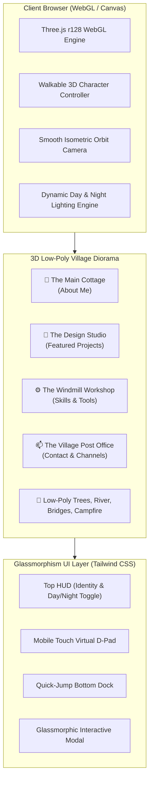

<div align="center">

# 🏡 3D Low-Poly Village Portfolio

### **An Immersive, Interactive 3D WebGL Portfolio Built with Three.js & Tailwind CSS**

<p align="center">
  <a href="https://mujahidul80.github.io/3d-low-poly-village-portfolio/"></a>
  <a href="https://vercel.com/new/clone?repository-url=https%3A%2F%2Fgithub.com%2Fmujahidul80%2F3d-low-poly-village-portfolio"></a>
  <a href="https://github.com/mujahidul80/3d-low-poly-village-portfolio/stargazers"></a>
  <a href="LICENSE"></a>
</p>

<p align="center">
  
  
  
  
  
  
</p>

---

[🌐 Live Demo](#-live-demo--preview) •
[✨ Key Features](#-key-features) •
[🗺️ Village Map](#%EF%B8%8F-village-landmarks) •
[🕹️ Controls](#%EF%B8%8F-controls-guide) •
[🔍 SEO Architecture](#-seo--accessibility-architecture) •
[🚀 Deployment](#-deployment-options) •
[👤 Author](#-author--connect)

</div>

---

## 🌐 Live Demo & Preview

> **💡 Zero Setup Required:**  
> This is a **100% self-contained client-side Web application**. All 3D assets, lighting, animations, and environments are procedurally generated in WebGL. No large 3D file downloads (`.gltf`/`.glb`) or external rendering engines are required. It opens directly in any web browser on desktop, tablet, and mobile!

- 🔗 **Live Web Demo:** [**Explore 3D Village Portfolio**](https://mujahidul80.github.io/3d-low-poly-village-portfolio/)
- 🚀 **1-Click Free Vercel Deploy:** Deploy your own live instance with custom domain in 60 seconds!

---

## 🏛️ Architecture & Diorama Layout



---

## ✨ Key Features

### 1. 🕹️ Interactive 3D Character & Physics
- **Free Movement:** Move the 3D adventurer freely across the low-poly floating diorama island using `WASD`, arrow keys, touch gestures, or on-screen controls.
- **Island Boundaries & Collisions:** Circular island bounds checking with natural collision detection against buildings, rocks, and water bodies.
- **Dynamic Limb Animation:** Procedural walking animation with synchronized arm swings, leg strides, and torso bobs.

### 2. 🏡 Proximity Interactive Zones & Modals
- **Glowing Trigger Rings:** Approach any building to illuminate animated ground rings and auto-trigger detailed information modals.
- **Smart Exit Locks:** Clean debounce logic allows users to close a modal with `ESC` or click without immediate re-triggering until exiting and re-entering the zone.
- **Floating 3D Labels:** 2D screen-projected HTML badges hover above buildings with real-time world-to-screen coordinate mapping.

### 3. 🌗 Real-Time Day / Night Atmosphere
- **One-Click Switcher:** Toggle smoothly between vibrant daylight and cozy nighttime cyber/moonlight aesthetics.
- **Dynamic Sky & Fog Interpolation:** Real-time color transition between daylight sky blues and deep midnight blues with distance fog.
- **Animated Point Lights & Glowing Windows:** Street lanterns, cottage windows, and flickering campfire flames illuminate with soft shadows upon nightfall.

### 4. 📱 Mobile-First Controls & Responsiveness
- **Virtual D-Pad:** 4-way thumb controls on mobile screens with tactile active feedback.
- **Quick-Jump Bottom Dock:** Instant navigation dock to walk the character automatically to any landmark (`About`, `Projects`, `Skills`, `Contact`).
- **Touch Orbit & Pinch Zoom:** Full one-finger and multi-touch support for rotating and zooming the isometric camera.

---

## 🗺️ Village Landmarks

| Landmark | Representation | Focus Area | Direct Action |
| :--- | :--- | :--- | :--- |
| **🏡 The Main Cottage** | About Me | Packaging Design & Creative Web Dev | Overview of background & core positioning |
| **🎨 The Design Studio** | Projects | Packaging, Branding, JSX Automation | Direct links to Behance & GitHub repos |
| **⚙️ The Windmill Workshop** | Skills | Adobe Illustrator, Dielines, JS, Three.js | Categorized visual technical skill badges |
| **📫 The Village Post Office** | Contact | Behance, GitHub, WhatsApp, Email | Interactive social launcher dock |
| **🔥 Low-Poly Campfire** | Atmosphere | Interactive Gathering Spot | Animated fire particles & flicker lighting |
| **🌊 Village River & Pond** | Environment | Water Reflections & Low-Poly Bridges | Expanding ripple physics animations |

---

## 🕹️ Controls Guide

| Action | Desktop Controls | Mobile / Touch Controls |
| :--- | :--- | :--- |
| **Walk Character** | `W` `A` `S` `D` or `Arrow Keys` | On-Screen Virtual D-Pad (Bottom Right) |
| **Orbit Camera** | Left-Click & Drag Canvas | One-Finger Drag on empty screen area |
| **Zoom In / Out** | Mouse Scroll Wheel | Multi-finger touch pinch |
| **Quick Navigate** | Bottom Dock Buttons | Bottom Dock Buttons (`About`, `Projects`, etc.) |
| **Close Modal** | `ESC` Key or Close Button | Close Button or Tap Backdrop |
| **Day / Night Toggle** | Header Button (Top Right) | Header Button (Top Right) |

---

## 🔍 SEO & Accessibility Architecture

This project is built with comprehensive SEO optimizations to ensure top rankings and complete search engine discoverability:

1. **Schema.org JSON-LD Graph:**
   - Full structured data graph featuring `Person`, `WebSite`, and `WebPage` schemas.
   - Comprehensive `sameAs` array connecting verified profiles across GitHub, Behance, Blogspot, Instagram, and Facebook.
   - `knowsAbout` technical capability tags.
2. **Open Graph & Twitter Cards:**
   - Rich social preview cards formatted for Facebook, Twitter/X, LinkedIn, and Discord embeds.
3. **Search Engine Crawler Fallback (`<noscript>` & `.sr-only`):**
   - Headless web crawlers (such as Googlebot and Bingbot) often do not execute complex WebGL scenes. A fully structured semantic fallback contains complete headings (`h1`-`h3`), descriptive copy, and direct links ensuring 100% crawlability.
4. **Search Directives:**
   - Pre-configured `robots.txt`, `sitemap.xml`, and canonical URL references.

---

## 🚀 Deployment Options

### Option 1: 1-Click Vercel Deployment

Deploy instantly with zero configuration:

[](https://vercel.com/new/clone?repository-url=https%3A%2F%2Fgithub.com%2Fmujahidul80%2F3d-low-poly-village-portfolio)

### Option 2: GitHub Pages (Automatic Workflow Included)

This repository includes a pre-configured `.github/workflows/deploy.yml` action:
1. Go to your repository settings: **Settings > Pages**.
2. Under **Build and deployment > Source**, select **GitHub Actions**.
3. Any push to the `main` branch will automatically deploy your portfolio live to `https://mujahidul80.github.io/3d-low-poly-village-portfolio/`.

### Option 3: Local Development

No package installation or build steps are strictly required. You can simply double-click `index.html` to open it in your browser.

To run with a local development server:
```bash
# Clone the repository
git clone https://github.com/mujahidul80/3d-low-poly-village-portfolio.git
cd 3d-low-poly-village-portfolio

# Start a local static server
npm run dev
# or
npx serve .
```

---

## 📁 Repository File Structure

```
├── .github/
│   └── workflows/
│       └── deploy.yml          # Automated GitHub Pages CI/CD workflow
├── public/                     # Static media and preview assets
├── .gitignore                  # Git ignore rules
├── index.html                  # Full 3D Village Portfolio with SEO & WebGL
├── LICENSE                     # MIT License
├── package.json                # Project metadata & convenience scripts
├── README.md                   # Comprehensive documentation
├── robots.txt                  # Search engine crawler directives
├── sitemap.xml                 # XML sitemap for SEO indexing
└── vercel.json                 # Vercel deployment configuration & security headers
```

---

## 👤 Author & Verified Connect

**Md Mujahidul Islam**  
*Packaging Designer • Graphic Designer • Creative Web Developer*

<p align="left">
  <a href="https://wa.me/8801571432927"></a>
  <a href="mailto:mdmujahidul31@gmail.com"></a>
  <a href="https://t.me/failuretm"></a>
  <a href="https://www.behance.net/mujahidulib"></a>
  <a href="https://github.com/mujahidul80"></a>
  <a href="https://mujahidulib.blogspot.com"></a>
  
</p>

### 📬 Direct Channels & Availability

| Channel | Direct Access / Handle | Availability & Purpose | Action |
| :--- | :--- | :--- | :--- |
| **💬 WhatsApp** | `+880 1571-432927` | Direct chat, instant project inquiries & fast turnaround | [**Start WhatsApp Chat**](https://wa.me/8801571432927) |
| **✉️ Official Email** | `mdmujahidul31@gmail.com` | Formal proposals, design briefs & commercial contracts | [**Send Email**](mailto:mdmujahidul31@gmail.com) |
| **✈️ Telegram** | `@failuretm` | Quick messaging, files & international communication | [**Open Telegram**](https://t.me/failuretm) |
| **🎨 Behance** | `behance.net/mujahidulib` | Packaging design, 3D mockups, print dielines & branding | [**View Portfolio**](https://www.behance.net/mujahidulib) |
| **💻 GitHub** | `github.com/mujahidul80` | Open-source web platforms, Adobe Illustrator scripts | [**Inspect Repos**](https://github.com/mujahidul80) |
| **🌐 Personal Blog** | `mujahidulib.blogspot.com` | Design logs, premium themes & creative tutorials | [**Visit Blog**](https://mujahidulib.blogspot.com) |
| **📸 Instagram** | `@mujahidul_i3` | Creative artwork, typography & visual explorations | [**Follow**](https://instagram.com/mujahidul_i3) |
| **📘 Facebook** | `Md Mujahidul Islam` | Social network & personal updates | [**Connect**](https://facebook.com/MUJAHIDUL.IB.LOVE.A.MA.BABA.50) |
| **📍 Location** | `Dhaka, Bangladesh (GMT+6)` | Remote worldwide & on-site project collaboration | Open for Remote Work |

---

## 📄 License

This project is open-source and available under the [MIT License](LICENSE).  
© 2026 **Md Mujahidul Islam**. All rights reserved.
